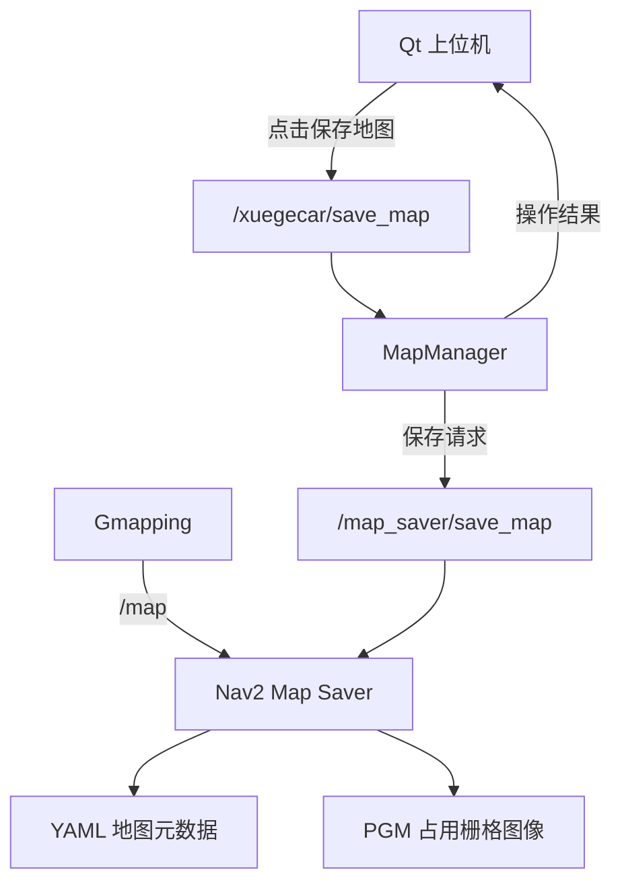

<div align="center">

# 🗺️ XuegeCar MapManager

### 基于 ROS 2 的智能小车地图保存管理模块

**ROS 2 智能小车二次开发系列 · 第二期**


**SLAM 地图保存 | ROS 2 Service | Qt 上位机集成 | 地图文件管理**

---

</div>

## 📌 项目来源与声明

> **特别感谢出云科技提供的 ROS 2 智能小车硬件平台、开源工程及相关技术资料！**
>
> 本项目基于出云科技提供的开源小车工程进行学习、研究与二次开发。
>
> 原始硬件平台及基础工程来源于出云科技。本文主要介绍本人针对地图保存流程所进行的功能封装、程序扩展与系统集成。
>
> 项目使用的 ROS 2、Gmapping、Nav2 等开源组件及算法归其各自项目和贡献者所有，本文不将其作为个人原创算法。
>
> 原始工程及第三方代码的使用、修改和分发应遵循相应的开源许可证。

---

## 📖 一、项目介绍

在传统 ROS 2 小车开发过程中，Gmapping 完成环境建图后，通常需要通过终端或地图保存服务，将实时地图保存为文件。

这种方式虽然能够完成任务，但在开发 Qt 一体化机器人上位机时，仍然存在一些不便：

- 📌 建图和地图保存操作分散。
- 📌 保存地图时需要关注底层 ROS 2 服务。
- 📌 多次建图容易产生地图文件版本混淆。
- 📌 地图保存结果缺少统一的上位机反馈入口。

为了解决上述问题，本项目在原有 Nav2 地图保存功能基础上，设计并集成了独立的地图管理模块：

### MapManager

通过 ROS 2 Service，将底层地图保存能力封装为一个统一的上层接口。

用户在 Qt 上位机点击 **“保存地图”**，即可发起地图保存请求。

> **设计目标：让 Qt 负责交互，让 MapManager 负责保存任务管理，让 Nav2 Map Saver 负责实际地图文件生成。**

---

## ✨ 二、核心功能

| 功能模块 | 主要作用 | 实现方式 |
| :--- | :--- | :--- |
| 🗺️ 地图保存 | 保存实时 SLAM 地图 | 调用 Nav2 Map Saver |
| 🔗 服务封装 | 提供上位机统一调用接口 | ROS 2 Service |
| 📁 地图文件管理 | 将地图保存到指定目录 | 文件路径管理 |
| 🕒 时间戳命名 | 区分不同建图版本 | 时间戳文件名称 |
| 📋 状态反馈 | 向上位机返回保存结果 | ROS 2 服务响应 |
| 🖥️ Qt 集成 | 通过图形界面触发保存 | Qt 与 ROS 2 通信 |

本模块主要解决的是地图保存功能的工程化集成问题，而不是重新实现 Gmapping 或 Nav2 的底层地图存储算法。

---

## 🧩 三、系统架构

### 3.1 地图保存调用关系



### 3.2 各模块职责

| 模块 | 职责 |
| :--- | :--- |
| **Gmapping** | 利用激光雷达和里程计数据构建实时地图 |
| **Qt 上位机** | 提供地图保存按钮和操作反馈 |
| **MapManager** | 接收保存请求并衔接底层保存服务 |
| **Nav2 Map Saver** | 将占用栅格地图写入文件 |

整个保存流程采用分层设计，减少 Qt 界面与底层地图保存功能之间的直接耦合。

---

## ⚙️ 四、运行环境

| 环境 | 版本或组件 |
| :--- | :--- |
| 操作系统 | Ubuntu 22.04 |
| ROS 2 | Humble |
| 编程语言 | Python 3 |
| SLAM | Gmapping |
| 地图保存 | Nav2 Map Saver |
| 图形界面 | Qt |
| 项目平台 | XuegeCar 智能小车 |

### 主要依赖

- `rclpy`
- ROS 2 服务接口
- `nav2_map_server`
- `nav2_msgs`
- 原工程中的建图 Launch 文件

**注意：** 该仓库主要展示地图管理模块，不能脱离原有 ROS 2 工作空间和相关依赖独立完成完整建图流程。

---

## 🚀 五、运行方法

### 5.1 加载 ROS 2 环境

在 Ubuntu 终端执行：

```bash
source /opt/ros/humble/setup.bash
source ~/xuegeros_ws/install/setup.bash
```

### 5.2 启动地图管理节点

```bash
ros2 run xuegecar_system map_manager
```

前提是 `xuegecar_system` 软件包已正确安装，并注册 `map_manager` 可执行入口。

### 5.3 检查地图保存服务

在 Gmapping 建图模式已正常运行时，执行：

```bash
ros2 service list | grep save_map
```

正常情况下，应当能找到：

```text
/map_saver/save_map
/xuegecar/save_map
```

其中：

- `/map_saver/save_map`：Nav2 提供的地图保存服务。
- `/xuegecar/save_map`：本项目向 Qt 提供的地图保存接口。

可进一步确认实际服务类型：

```bash
ros2 service type /xuegecar/save_map
```

### 5.4 使用 Qt 保存地图

1. 启动 XuegeCar Qt 上位机。
2. 点击 **开始建图**。
3. 使用小车缓慢探索环境。
4. 等待实时地图更新。
5. 让小车停止运动。
6. 点击 **保存地图**。
7. 观察 Qt 操作日志中的保存结果。

不需要另外编写地图保存算法。

---

## 📂 六、地图文件说明

当前项目使用的地图目录：

```text
/home/chuyun/maps/
```

地图保存成功后，可以在目录中找到类似文件：

```text
maps/
├── map_20261028_150300.yaml
├── map_20261028_150300.pgm
├── map_20261028_153500.yaml
└── map_20261028_153500.pgm
```

以上为示例文件名，实际名称以运行结果为准。

### YAML 与 PGM 的区别

| 文件类型 | 主要内容 |
| :--- | :--- |
| `.yaml` | 地图分辨率、原点、图像路径及占用阈值 |
| `.pgm` | 二维占用栅格地图图像 |

一组 YAML 和 PGM 文件共同组成可供后续定位与导航系统加载的二维地图。

### 检查保存结果

```bash
ls -lht ~/maps | head -15
```

可以通过文件生成时间判断最新保存的地图。

---

## 🛠️ 七、二次开发设计亮点

### 7.1 地图保存服务化

将底层 Nav2 地图保存操作统一封装为上层 ROS 2 服务接口。

上位机不需要直接管理地图保存进程，只需要发送请求并接收结果。

### 7.2 地图文件版本区分

采用带时间信息的地图名称，方便区分不同建图实验的保存结果。

这种方式能够降低重复使用固定文件名导致的覆盖和混淆风险。

### 7.3 Qt 图形化操作集成

地图保存功能直接集成到机器人上位机。

与第一期的 ModeManager 配合，可以形成：


通过统一图形界面完成建图与保存操作，提高系统的操作便利性。

---

## 🧪 八、功能验证

本项目已经进行了实际地图保存测试。

验证内容包括：

| 验证项目 | 测试结果 |
| :--- | :--- |
| Gmapping 建图启动 | 已验证 |
| Qt 保存地图按钮 | 已验证 |
| 地图保存服务调用 | 已验证 |
| YAML 文件生成 | 已验证 |
| PGM 文件生成 | 已验证 |

**说明：** 地图保存成功不代表地图一定满足自主导航要求。地图质量仍受到雷达数据、里程计精度、机器人运动过程和环境覆盖程度等因素影响。

---

---

## 📜 九、开源声明

本仓库用于 ROS 2 智能机器人技术学习、工程实践和二次开发交流。

原始小车硬件与基础开源工程来源于出云科技。

本仓库的具体许可证将在核实原始代码授权情况后确定。第三方开源项目继续遵循各自的许可证要求。

---

<div align="center">

### ⭐ 感谢出云科技与 ROS 2 开源社区

**XuegeCar Secondary Development Project**

*让机器人开发从命令行操作，逐步走向模块化与图形化集成。*

</div>
